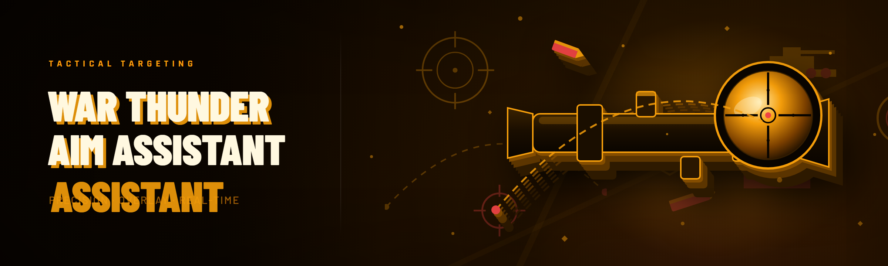

  
  
  

  

  
  

---

War Thunder aimbot with ESP, wallhack, projectile lead prediction and injector bypass for arcade and realistic battles.

## Overview

War Thunder aimbot with ESP, wallhack, projectile lead prediction and injector bypass for arcade and realistic battles.

  

## License

[MIT License](LICENSE)

  

